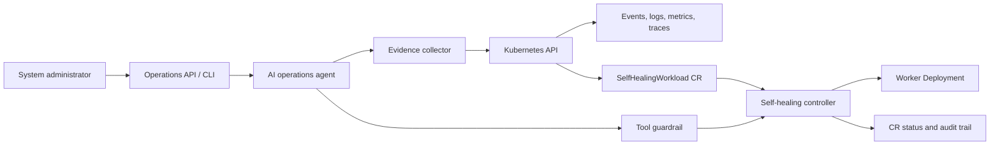

# Kubernetes Self-Healing Service Controller

Phase 2 implementation of a controller that keeps distributed worker workloads healthy and exposes an agent-assisted operations workflow.

## Phase 1 foundation

The first milestone defined the MVP, custom resource contract, local cluster topology, and reproducible sample workload. Those deliverables remain in this repository alongside the Phase 2 controller implementation.

### MVP acceptance criteria

1. A `SelfHealingWorkload` resource declares the desired worker replica count and container image.
2. The controller will eventually maintain the desired number of workers and report observed state in `.status`.
3. The sample workload can be deployed to a local kind or Minikube cluster.
4. A worker can be made unhealthy by changing its readiness endpoint; Kubernetes will replace failed Deployment pods and the controller will report the observed condition.
5. Agent actions are planned as read-only evidence collection first, with guarded mutations requiring explicit policy approval.

## Architecture



### Component responsibilities

| Component | Responsibility |
|---|---|
| `SelfHealingWorkload` CRD | Desired replicas, worker image, retry policy, and agent policy boundary |
| Controller | Reconcile desired state, create/update the worker Deployment, and publish status |
| Worker Deployment | Run the distributed worker replicas and expose health checks |
| Evidence collector | Gather Kubernetes events, logs, metrics, traces, health checks, and deployment history |
| Operations agent | Summarize evidence, identify likely causes, and propose a recovery action |
| Tool guardrail | Allow safe reads, require approval for risky actions, and deny cross-workload or unsafe mutations |

## Local setup

Prerequisites: Docker, `kubectl`, and either kind or Minikube.

```bash
kind create cluster --name self-healing-demo
kubectl apply -f deploy/namespace.yaml
kubectl apply -f deploy/crd.yaml
kubectl apply -f deploy/sample-workload.yaml
kubectl -n self-healing-demo get selfhealingworkload,deploy,pods
```

The sample image uses `nginx:1.27` and exposes `/` on port 80 through the deployment's readiness and liveness probes. The controller reconciles the Deployment and Service from the custom resource.

## Run the Phase 2 controller

Create a Python environment, install the Kubernetes client, and start the
controller after the cluster and manifests are ready:

```bash
python3 -m venv .venv
source .venv/bin/activate
python3 -m pip install -r requirements.txt
PYTHONPATH=. python3 -m controller.main
```

The controller polls the namespace every five seconds by default. Set
`WATCH_NAMESPACE` or `RECONCILE_INTERVAL_SECONDS` to change those defaults.
It creates or patches the Deployment and Service, then publishes ready and
desired replica counts plus an `Available` or `Degraded` condition to the
custom resource status.

Clean up:

```bash
kubectl delete namespace self-healing-demo
kind delete cluster --name self-healing-demo
```

## Phase 1 and Phase 2 deliverables

- `docs/project-scope.md`: scope, assumptions, risks, and acceptance criteria.
- `docs/architecture.md`: component boundaries and recovery flow.
- `deploy/crd.yaml`: versioned custom resource definition.
- `deploy/sample-workload.yaml`: local demo resource and worker workload reference.
- `deploy/namespace.yaml`: isolated namespace for local testing.
- `deploy/kind-config.yaml`: optional local kind configuration.
- `controller/reconciler.py`: deterministic, testable reconciliation logic.
- `controller/main.py`: Kubernetes polling entrypoint.
- `tests/test_reconciler.py`: Phase 2 unit tests.

Run the Phase 2 tests without a cluster:

```bash
PYTHONPATH=. python3 -m unittest discover -s tests -v
```

## Planned timeline

With three people working in parallel, the complete MVP is estimated at 10 weeks. Phase 1 is estimated at one week; Phase 2 covers controller reconciliation and tests; Phase 3 covers evidence collection, the operations agent, and guardrails; and Phases 4–5 cover integration, hardening, documentation, and the final demo.

