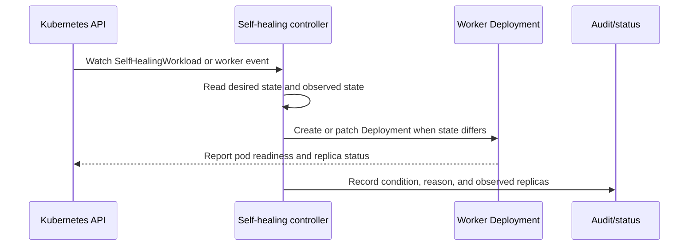
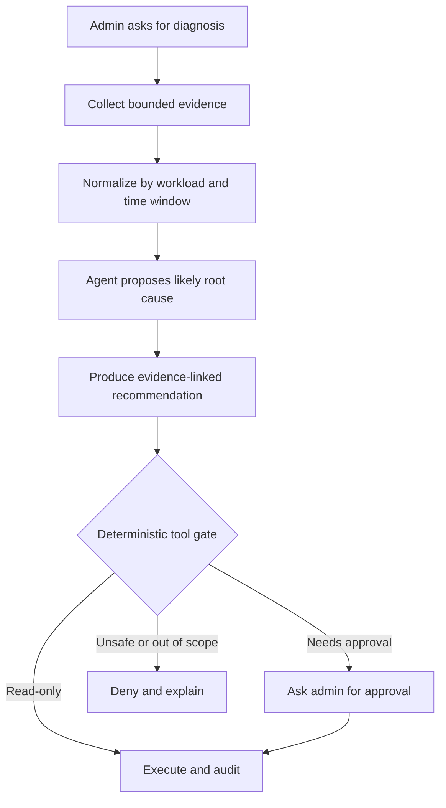

# Architecture and recovery flow

## Reconciliation flow

## Agent-assisted diagnosis flow

## Custom resource design

The resource separates desired state (`spec`) from observed state (`status`). The controller owns status conditions and observed replica counts. The operations agent never writes directly to the resource without passing through the action gate.

### Status conditions

- `Available`: desired replicas are ready.
- `Degraded`: one or more replicas are unavailable or tasks are retrying.
- `Recovering`: a remediation is in progress.
- `Blocked`: policy, missing evidence, or approval prevents remediation.

